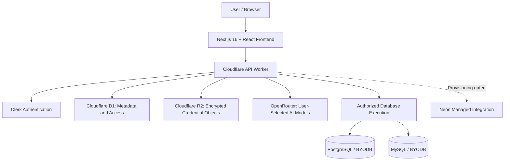
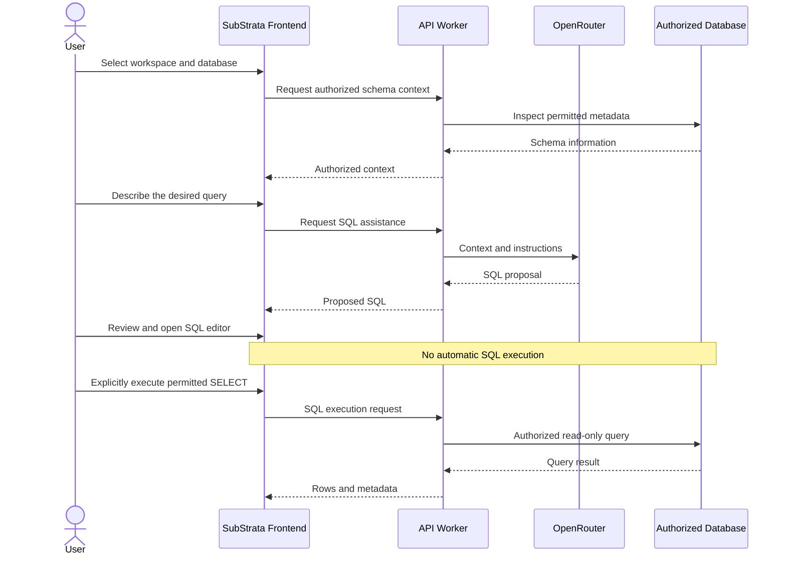

 <div align="center">

# SubStrata Engine

### A Serverless, Multi-Tenant Database Workspace with AI-Assisted SQL and Agents


<br/>


<br/>


**[Live Deployment — Coming Soon](https://example.com/replace-with-substrata-staging-url)** · [Source Code](https://github.com/Adityaraj-Gupta-JI/SubStrata-Engine) · [Discussions](https://github.com/Adityaraj-Gupta-JI/SubStrata-Engine/discussions) · [Releases](https://github.com/Adityaraj-Gupta-JI/SubStrata-Engine/releases)

<sub>Deployment URL is a placeholder until the isolated Cloudflare environment passes hosted acceptance.</sub>

</div>

---

## 📌 Overview

**SubStrata Engine** is a serverless-first, multi-tenant platform for exploring, querying and managing database connections through a unified web interface.

It combines conventional database tools with AI-assisted workflows while keeping database operations subject to explicit authorization and execution controls.

Two principles define the platform:

- **BYODB — Bring Your Own Database:** Connect an existing supported database instead of being required to migrate its data into a new platform.
- **BYOK — Bring Your Own Key:** Configure a personal OpenRouter API key and choose an available AI model rather than relying on a single platform-owned model credential.

SubStrata brings together database exploration, SQL editing, AI chat, saved conversations, configurable agents and workspace management.

**Current maturity:** The core read-only MVP has passed local browser acceptance with genuine Clerk authentication, PostgreSQL execution and OpenRouter requests. Hosted deployment and production-readiness validation remain separate milestones.

## 🎯 Problem Statement

Database administration and AI-assisted data exploration often involve several disconnected tools:

- Database clients for inspecting tables and executing SQL.
- Cloud dashboards for managing database connections.
- Separate AI applications for explaining schemas or generating queries.
- Manual processes for reviewing permissions and tracking activity.

Integrating these tools introduces additional configuration, context switching and security concerns. AI-generated SQL creates another challenge: a useful suggestion should not automatically become an authorized database operation.

## 💡 Proposed Solution

SubStrata provides a single workspace where authenticated users can:

1. Select an authorized workspace and database.
2. Explore schemas, tables, columns and relationships.
3. Inspect permitted records and execute read-only SQL.
4. Configure their own OpenRouter credentials.
5. Generate SQL proposals using database-aware AI assistance.
6. Review and explicitly execute permitted queries.
7. Run bounded AI agents and inspect execution traces.
8. Manage workspace access according to assigned permissions.

The application separates **AI reasoning**, **authorization** and **database execution**. Generated output is advisory until the user takes an allowed action.

## ✨ Core Capabilities

| Capability | Current implementation |
|---|---|
| Authentication | Clerk-based sign-in, session verification and protected routes |
| Workspaces | Workspace selection, membership roles and access controls |
| Database connectivity | BYODB PostgreSQL and constrained MySQL support |
| Database explorer | Schema, table, column, key and relationship inspection |
| SQL workspace | SQL editor, read-only query execution and result viewing |
| AI configuration | OpenRouter BYOK, encrypted credential storage and model selection |
| AI chat | Streaming responses, saved conversations, cancellation and recovery |
| AI SQL assistance | Schema-aware SQL proposals with editable editor handoff |
| AI agents | Schema Analyst, Query Assistant and Data Explorer |
| Agent observability | Bounded execution, step traces, history and cancellation |
| Activity | Persisted workspace and execution-related activity |
| Managed database integration | Neon integration present; provisioning remains disabled pending configuration and approval |

### AI agents

| Agent | Purpose |
|---|---|
| **Schema Analyst** | Examine database structure, columns, keys and relationships |
| **Query Assistant** | Assist with SQL generation and query understanding |
| **Data Explorer** | Explore authorized data through bounded, permission-controlled tools |

Agent actions are subject to backend permissions and execution limits. Model output is not treated as an independent authorization source.

## 🏗️ System Architecture



### Architecture responsibilities

| Layer | Technology | Responsibility |
|---|---|---|
| Frontend | Next.js 16, React, TypeScript, Tailwind CSS | Application UI, navigation, editor, explorer, chat and agents |
| API | Cloudflare Workers, TypeScript | Authenticated routes, authorization, orchestration and execution boundaries |
| Identity | Clerk | User authentication and session verification |
| Control plane | Cloudflare D1 | Users, workspaces, memberships, metadata and audit records |
| Credential storage | Cloudflare R2 + AES-256-GCM | Encrypted BYOK and database credential storage |
| AI provider | OpenRouter | Model discovery, inference and streaming responses |
| Database access | PostgreSQL and constrained MySQL adapters | Authorized schema inspection and query execution |
| Managed database integration | Neon | Managed PostgreSQL lifecycle integration, subject to provisioning gates |
| Deployment | Cloudflare Workers + OpenNext | Serverless frontend and API packaging |

**Important distinction:** D1 is the application's control-plane database. User-connected PostgreSQL/MySQL databases are separate data sources. R2 stores encrypted credential objects; encryption keys remain in backend secret configuration.

### AI-assisted SQL workflow



## 🛡️ Security and Isolation

SubStrata uses multiple controls rather than relying on AI-generated instructions for database safety.

- **Authenticated requests:** API access is associated with verified Clerk sessions.
- **Workspace authorization:** Membership and permissions are enforced through backend-controlled workspace records.
- **Tenant isolation:** Database connections, conversations and agent operations are scoped to authorized workspaces.
- **Encrypted credentials:** BYOK credentials are encrypted before persistence; encryption keys are not exposed through the frontend.
- **Read-only default:** SQL execution is restricted by the applicable database adapter and authorization policy.
- **Explicit execution:** AI-generated SQL proposals do not run automatically.
- **Bounded agents:** Agent execution uses tool restrictions, step limits, cancellation and trace records.
- **Connection validation:** BYODB connections are subject to network and connection security checks.

These controls reduce risk but do not constitute a claim of formal security certification or production penetration testing.

## 🛠️ Technology Stack

| Category | Technologies |
|---|---|
| Web application | Next.js 16, React 19, TypeScript |
| Interface | Tailwind CSS, Lucide React |
| Backend | Cloudflare Workers, TypeScript |
| Hosting adapter | OpenNext |
| Authentication | Clerk |
| Metadata and access | Cloudflare D1 |
| Credential vault | Cloudflare R2, AES-256-GCM |
| Relational databases | PostgreSQL, MySQL (limited support) |
| Managed database provider | Neon |
| AI orchestration | OpenRouter, provider-backed streaming and bounded tools |
| Testing | Automated frontend/Worker tests, browser smoke tests, local database fixtures |
| Tooling | Node.js, npm, Wrangler, Git and GitHub |

The repository also retains legacy Python/FastAPI material from an earlier architecture. That is not the primary runtime of the current serverless MVP.

## 📂 Application Modules

| Route | Purpose |
|---|---|
| `/login`, `/register` | Authentication entry points |
| `/onboarding` | Initial workspace setup |
| `/dashboard` | Workspace overview and activity |
| `/databases` | Database connections and management |
| `/explorer` | Schema and relationship exploration |
| `/sql`, `/sql-editor` | SQL workspace and query execution |
| `/chat` | AI conversations and SQL assistance |
| `/agents` | Agent configuration, runs and history |
| `/settings/ai` | BYOK configuration and model selection |
| `/settings/access` | Workspace membership and access |
| `/settings/account` | Account settings |

## 🚀 Local Development

### Requirements

- Node.js and npm compatible with the repository's package manifests.
- Wrangler / Cloudflare Workers local development support.
- Clerk development application and credentials.
- Local D1 and R2 bindings configured for the API Worker.
- A supported PostgreSQL database for database-query acceptance.
- Optional MySQL instance for supported BYODB testing.
- Optional OpenRouter API key, entered by the user through the application.

Use the versions and configuration examples committed in the repository as the source of truth.

### 1. Clone the repository

```bash
git clone --branch dev/substrata-v2 https://github.com/Adityaraj-Gupta-JI/SubStrata-Engine.git
cd SubStrata-Engine
```

### 2. Install dependencies

From the repository root:

```bash
cd worker
npm install

cd ../frontend
npm install
```

### 3. Configure the local environment

Configure the frontend's Clerk publishable key and local API URL using the repository's existing frontend environment convention.

The frontend needs:

```dotenv
NEXT_PUBLIC_CLERK_PUBLISHABLE_KEY=YOUR_CLERK_PUBLISHABLE_KEY
NEXT_PUBLIC_PLATFORM_API_URL=http://localhost:8787
```

Configure the API Worker through its private `worker/.dev.vars` file and the relevant Wrangler bindings.

The API requires appropriate Clerk settings and local D1/R2 configuration. AI credential storage additionally requires:

- `AI_VAULT_KEY_ID` — active encryption key identifier.
- `AI_VAULT_KEYS` — private JSON keyring containing a matching 32-byte encryption key encoded as 64 hexadecimal characters.
- `TENANT_CREDENTIALS` — configured R2 binding.

**Never commit `.dev.vars`, real API keys, database passwords, session tokens or encryption keys.**

An OpenRouter provider key is **not** a global backend environment variable. Each user supplies their own credential through `/settings/ai`.

### 4. Prepare local metadata storage

Apply the repository's existing D1 migrations using the local Wrangler configuration. Use the documented migration scripts and environment settings for the current branch.

Do not apply migrations to remote resources during local setup.

### 5. Start the API

In one terminal:

```bash
cd worker
npm run dev
```

The normal local API is expected at `http://localhost:8787` when using the established development configuration.

### 6. Start the frontend

In another terminal:

```bash
cd frontend
npm run dev
```

Open `http://localhost:3000`.

### 7. Use the application

1. Sign in through Clerk and select or create an authorized workspace.
2. Connect a supported database or select an available configured database.
3. Inspect tables, columns and relationships in Explorer.
4. Execute a permitted read-only SQL query.
5. Open **Settings → AI** and enter your OpenRouter API key.
6. Validate and save the credential using encrypted storage.
7. Choose an available compatible model.
8. Use Chat to request a SQL proposal.
9. Review the proposal and explicitly execute it in the SQL editor if appropriate.
10. Explore the three agent templates and inspect their traces.

Some functions require external provider accounts, credentials or owner-side configuration.

## 🧪 Validation and Testing

The October 2026 local acceptance cycle exercised:

- Genuine Clerk authentication, workspace access and logout.
- PostgreSQL schema exploration and read-only SQL execution.
- Encrypted OpenRouter credential validation and persistence.
- Real model discovery and streaming chat.
- Database-aware SQL proposals and explicit SQL execution.
- All three AI agent templates with real provider responses.
- Chat and agent cancellation.
- Conversation/run restoration after refresh.
- Membership mutations and authorization checks.

Automated tests, typechecks, linting, production builds and Cloudflare packaging checks were also performed.

**Scope:** These results support the tested local MVP. They do not establish hosted production availability, comprehensive load testing or support for every provider/database configuration.

## ⚠️ Current Limitations

- The new isolated Cloudflare staging deployment is pending.
- Managed Neon provisioning remains disabled until separately configured and approved.
- Database writes are not part of the currently accepted read-only release scope.
- MySQL support is more constrained than PostgreSQL; write and view-management capabilities are not available through the current MySQL adapter.
- OpenRouter model capabilities, quotas, pricing and availability vary by provider and account.
- AI-generated SQL and summaries require review; they are not guaranteed correct.
- Agent data previews are bounded and must not be interpreted as complete table scans.
- Production load, disaster recovery and operational monitoring require additional validation.

## 🗺️ Roadmap

The roadmap distinguishes delivered local functionality from planned expansion.

| Phase | Focus | Status |
|---|---|---|
| MVP / Release Candidate | Workspaces, database explorer, SQL, BYOK chat, agents | Local acceptance completed |
| Hosted Staging | Isolated Cloudflare resources, hosted browser acceptance | Planned |
| UX Improvements | Responsive refinements, theme controls, accessibility | Planned |
| Product Management | Subscription and plan visualization, account usage | Planned |
| Documentation | BRD, PRD, SRS, technical architecture and user guides | Planned |
| Advanced Database Operations | Expanded controlled editing, provisioning and database support | Future, gated |
| Advanced Visualization | Richer schema graphs, execution visualizations and relationship exploration | Future |
| Extended Intelligence | More advanced agent workflows and optional semantic/vector capabilities | Exploratory |

Potential future capabilities are not represented as available in the current MVP.

## 📦 Releases and Deployment

**Current state:** Locally validated release candidate. The new hosted deployment has not yet passed staging acceptance.

- [Release history](https://github.com/Adityaraj-Gupta-JI/SubStrata-Engine/releases)
- [Development branch](https://github.com/Adityaraj-Gupta-JI/SubStrata-Engine/tree/dev/substrata-v2)
- [Deployment — URL pending](https://example.com/replace-with-substrata-staging-url)

The staging architecture uses separate frontend and API Workers, D1 metadata storage, private R2 credential storage and dedicated authentication configuration.

Deployment requires a clean release build, verified cloud resources, protected secrets and hosted acceptance. Local development secrets must not be bundled into deployable frontend artifacts.

## 👥 Team and Contributions

| Contributor | Project role |
|---|---|
| **Adityaraj Gupta** | Backend systems and database infrastructure |
| **A. N. Yashas Kiran** | Frontend architecture and user experience |
| **Krishna Agrawal** | Full-stack integration and AI systems |

The roles above reflect the project team's documented responsibilities. Individual contributions and implementation history can be reviewed through repository commits.

**Project repository:** [Adityaraj-Gupta-JI/SubStrata-Engine](https://github.com/Adityaraj-Gupta-JI/SubStrata-Engine)

## 📚 Documentation and References

Project documentation is maintained in the repository's `docs/` directory. More complete business requirements, product requirements, software requirements, architecture and operational documentation are planned.

Technical references:

- [Next.js](https://nextjs.org/docs)
- [Cloudflare Workers](https://developers.cloudflare.com/workers/)
- [Cloudflare D1](https://developers.cloudflare.com/d1/)
- [Cloudflare R2](https://developers.cloudflare.com/r2/)
- [Clerk](https://clerk.com/docs)
- [PostgreSQL](https://www.postgresql.org/docs/)
- [MySQL](https://dev.mysql.com/doc/)
- [OpenRouter](https://openrouter.ai/docs)
- [Neon](https://neon.com/docs)

## 💬 Discussions and Feedback

Use [GitHub Discussions](https://github.com/Adityaraj-Gupta-JI/SubStrata-Engine/discussions) for technical questions, architecture discussions, ideas and feedback.

Please avoid posting credentials, database connection strings or sensitive records in public discussions or issues.

## 📄 License and Ownership

**SubStrata Engine is proprietary, owner-licensed project material. All rights reserved.**

Public repository visibility does not itself grant permission to copy, redistribute, modify, commercialize or create derivative works from the project's original source code and documentation.

Third-party dependencies remain subject to their respective licenses and terms. Refer to the repository's `LICENSE` file for the applicable licensing text.

## 🙏 Acknowledgments

The team acknowledges the maintainers and communities behind the frameworks, database systems, cloud services and development tools used in this project.

SubStrata Engine is an independent academic and engineering project. References to third-party technologies do not imply their endorsement.

---

<div align="center">

**SubStrata Engine**

*Bring your database. Bring your model. Keep execution under control.*


</div> 